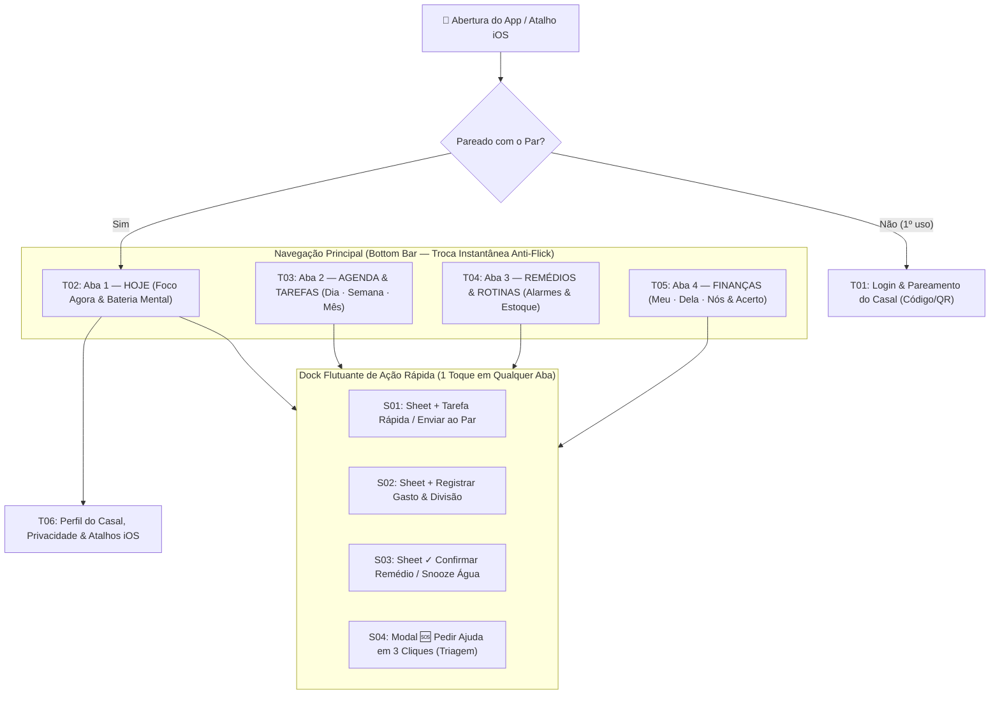

# 02. UX, Mapa de Navegação e Jornadas Críticas (Foco em TDAH)

## 1. Princípios de UX para TDAH Aplicados ao “Nós”

Pessoas com TDAH sofrem com **memória de trabalho curta**, **cegueira temporal** (só existem dois tempos: *"agora"* e *"não agora"*) e **paralisia por escolha**. Por isso, a arquitetura de UX do **“Nós”** segue 5 leis rígidas:

1. **A Próxima Ação vem antes do Histórico (`product-ui-system`):** A abertura do app nunca mostra relatórios passados ou listas completas do mês. Mostra o que está acontecendo **agora** e nas próximas horas.
2. **Regra dos 3 Segundos e 1 Mão:** Toda captura cotidiana é feita por uma **Gaveta Inferior (`Bottom Sheet`)** acionada pelo polegar na base da tela, com valores padrão inteligentes já selecionados (ex.: data = Hoje, quem pagou = Eu, divisão = padrão do casal).
3. **Desfazer Imediato (`Toast` com `[Desfazer]` do `ARQ-D`):** Pessoas com TDAH clicam rápido e por impulso. Não usamos modais de confirmação irritantes (*"Tem certeza que deseja concluir?"*); a ação acontece na hora e exibe um `Toast` por 5 segundos com botão **`[Desfazer]`**.
4. **Modo Sobrecarga / Bateria Mental (`100%` | `50%` | `10%`):** Quando o usuário marca que está em **`🪫 10% (Sobrecarga)`**, a tela `Hoje` esconde automaticamente tarefas secundárias e mostra apenas: **1 remédio/rotina essencial + 1 única próxima tarefa + botão grande de Pedir Ajuda ao Par**.
5. **Co-regulação Gentil (Zero Linguagem Punitiva):** Nada de alertas vermelhos agressivos dizendo *"Você falhou em 5 tarefas!"*. Tarefas não feitas no dia entram num card calmo pela manhã: *"3 itens de ontem ficaram pendentes. Quer trazer para hoje, passar algum para seu amor ou arquivar?"*.

---

## 2. Mapa de Navegação e Hierarquia de Telas

A navegação combina uma **Bottom Tab Bar limpa de 4 destinos** com o **Dock Flutuante de Captura Rápida (`+`)** inspirado no `ARQ-E` ([`saude-fisioterapia-odonto.md`](file:///C:/Users/Lucas/.gemini/config/skills/frontend-figma-playwright/pipeline-midia/exemplos-prontos/saude-fisioterapia-odonto.md)).



---

## 3. As 7 Jornadas Principais Passo a Passo

### Jornada 1: Capturar Tarefa (Pessoal ou para o Parceiro) em `< 3 segundos`
1. Usuário toca em **`+ Tarefa`** no Dock Inferior (ou aciona o Atalho do iPhone).
2. Abre a `S01: Sheet de Tarefa Rápida` com o teclado já focado no campo de título (`font-size: 16px`).
3. Abaixo do campo, 3 pílulas de destinatário prontas para 1 toque:
   - **`[ Para Mim ]`** (padrão) | **`[ Para Nós ]`** | **`[ Enviar para Amor 💌 ]`**
4. Seletor rápido de momento: **`[ Hoje ]`** | **`[ Amanhã ]`** | **`[ Sem data (Caixa de Entrada) ]`** e nível de esforço: **`[ ⚡ Rápido 5m ]`** | **`[ 🧠 Foco ]`**.
5. Toca em **`Salvar`**. Se foi marcada como *Enviar para Amor*, o parceiro recebe uma notificação gentil e um card de confirmação na tela `Hoje` dele.

### Jornada 2: Ver o Dia ("Aterrissagem Calma") e Regular a Bateria Mental
1. Ao abrir o app, a tela `T02: Hoje` exibe no cabeçalho o seu status de energia e o do parceiro (ex.: `Lucas: ⚡ Média` · `Namorada: 🔋 Cheia`).
2. **Bloco 1 — "Agora / Próxima Ação" (Destaque máximo):** Exibe o item mais urgente do momento (ex.: remédio das 09:00 ou compromisso das 10:30 ou pedido de ajuda do par).
3. **Bloco 2 — "Linha do Tempo do Dia":** Mistura em ordem cronológica os eventos da agenda, horários de remédios e até 3 tarefas-foco do dia.
4. **Se o usuário tocar em `🪫 Modo Sobrecarga`:** A lista encolhe suavemente; tudo o que não é crítico vai para a gaveta *"Pode esperar"* e aparece um aviso opcional para o parceiro: *"Lucas ativou o Modo Calmo hoje"*.

### Jornada 3: Receber Alarme e Tomar Remédio (Fluxo Anti-Cegueira de Alarme)

```mermaid
sequenceDiagram
    participant iOS as Alarme Local iOS (Time-Sensitive)
    participant User as Usuário (TDAH)
    participant App as Banco Local SQLite
    participant Par as Celular do Parceiro (Rede de Apoio)

    iOS->>User: 🔔 Dispara Alarme 09:00 ("Tomar Venvanse 30mg")
    alt Cenário A: Já está com água na mão
        User->>iOS: Clica na ação da notificação "✓ Já engoli"
        iOS->>App: Registra dose tomada (09:01) e desconta -1 da caixa
    else Cenário B: Precisa levantar para buscar água
        User->>iOS: Clica em "⏳ Pegando água (+5 min)"
        iOS->>iOS: Reagenda alarme prioritário para 09:05
        iOS->>User: 🔔 Toca novamente às 09:05 ("E aí, conseguiu tomar?")
        User->>iOS: Clica em "✓ Já engoli"
        iOS->>App: Registra dose tomada (09:05)
    else Cenário C: Ignorou / Esqueceu por 30 minutos (Rede de Apoio Ativa)
        App->>Par: 💛 Ping suave às 09:30 ("O remédio das 09h de Lucas ainda consta pendente. Manda um lembrete?")
        Par->>User: Toca em "Mandar lembrete carinhoso 💧"
    end
```

### Jornada 4: Registrar Gasto e Dividir Despesa (`Meu`, `Dela`, `Do Casal`)
1. Usuário toca em **`+ Gasto`** no Dock Flutuante.
2. Digita o valor no teclado numérico grande (`R$ 120,00`) e uma descrição curta (`"Farmácia"` ou escolhe chip rápido: `🛒 Mercado`, `🍔 Delivery`, `🏠 Casa`, `💊 Saúde`, `🎉 Lazer`).
3. Escolhe a pílula de dono do gasto:
   - Se tocar em **`[ Meu ]`**: salva direto no seu livro-razão pessoal (com checkbox opcional `🔒 Presente/Surpresa`).
   - Se tocar em **`[ Do Casal ]`**: exibe imediatamente a linha de divisão já preenchida com o padrão do casal:
     - **Quem pagou?** `[ Eu paguei ]` (padrão) | `[ Ela pagou ]`
     - **Como dividir?** `[ Padrão (50/50) ]` | `[ Proporcional ]` | `[ 100% para o outro (Adiantamento) ]`
4. Ao salvar, o card mostra na hora no `Toast`: *"Gasto salvo · Sua namorada fica com `R$ 60,00` pendentes no acerto do mês — `[Desfazer]`"*.

### Jornada 5: Ativar/Desativar Visualização Mútua dos Gastos Pessoais
1. Na aba **`T05: Finanças`**, existe o seletor de visão no topo: **`[ Nós (Casal) ]`** | **`[ Meu ]`** | **`[ Dela ]`**.
2. No canto superior da aba **`[ Meu ]`**, há um chip interativo claro:
   - **`👁️ Visível para ela: Ativado`** (ou **`🔒 Visível só para mim: Desativado`**).
3. Ao tocar nesse chip, o usuário liga ou desliga a permissão instantaneamente:
   - Quando **Ativado**, sua namorada consegue clicar na aba **`[ Dele ]`** no celular dela e ver seus gastos pessoais e quanto resta do seu orçamento do mês (exceto itens marcados com `🔒 Presente/Surpresa`).
   - Quando **Desativado**, a aba **`[ Dele ]`** no celular dela mostra um estado vazio respeitoso: *"Lucas está com a visão pessoal fechada no momento. Os gastos do casal continuam 100% visíveis na aba Nós."*

### Jornada 6: Pedir Ajuda ao Parceiro (Triagem Rápida em 3 Toques — Inspirada no `ARQ-E`)
Quando um dos dois trava numa tarefa ou está sobrecarregado, não precisa digitar um texto longo explicando:
1. Toca no botão **`🆘 Pedir Ajuda`** (no Dock ou dentro de uma tarefa).
2. **Passo 1 (O quê?):** Seleciona uma tarefa da lista de hoje ou toca em *"Estou travado(a) / sobrecarregado(a) geral"*.
3. **Passo 2 (Como você pode me ajudar?):**
   - `🤝 Fazer junto comigo (Body Doubling)` — *"Só preciso de companhia para começar"*
   - `🏃 Assumir por mim hoje` — *"Não vou dar conta, você consegue fazer?"*
   - `⏰ Me cobrar/lembrar mais tarde` — *"Me chama às 19h para eu fazer"*
4. **Passo 3 (Urgência):** `[ Agora ]` | `[ Ainda hoje ]` | `[ Até o fim da semana ]`.
5. O parceiro recebe um **Card de Pedido de Apoio** destacado no topo do app (e via Push) com botões de resposta em 1 toque: **`[ Deixa comigo! ❤️ ]`** | **`[ Vamos fazer juntos às... ]`**.

### Jornada 7: Atalhos Rápidos do iPhone (`iOS Shortcuts`)
Para evitar que a pessoa abra o iPhone para anotar algo, veja uma notificação do Instagram e esqueça o que ia fazer:
- O usuário pode configurar no **Botão de Ação (Action Button)**, no **Toque Atrás (Back Tap 2x/3x)** ou como **Widget na Tela Bloqueada** 4 atalhos diretos:
  1. `Nós: + Tarefa Rápida` (abre input nativo do iOS ou a `Sheet S01` direto).
  2. `Nós: + Registrar Gasto` (pergunta Valor → Categoria → Meu ou Casal e salva em background).
  3. `Nós: ✓ Tomei meu Remédio` (confirma o remédio do turno atual sem nem abrir a tela do app).
  4. `Nós: 🆘 Pedir Ajuda ao Amor` (dispara ping rápido ao parceiro).

---

## 4. Estados Vazios, Erros, Offline, Sincronização e Casos Extremos

| Situação / Estado | Comportamento Obrigatório na UI (`product-ui-system`) |
|---|---|
| **Empty State (Dia livre / Sem tarefas)** | Nunca mostrar tela branca vazia. Mostrar ícone calmo (`Sun` ou `Sparkles`), frase acolhedora (*"Nada urgente para agora. Aproveite o respiro!"*) e CTA secundário (`+ Planejar algo para hoje`). |
| **Offline (Sem internet)** | Pílula discreta no topo (`☁️ Modo Offline · Salvando no aparelho`). Todas as criações, edições, confirmações de remédio e gastos funcionam com **latência zero** no SQLite local. |
| **Sincronização & Conflitos** | Quando os dois editam o mesmo item offline:<ul><li>**Remédio/Tarefa concluída:** o status `Concluído/Tomado` sempre vence (*idempotente*), registrando quem concluiu primeiro.</li><li>**Gasto editado pelos dois:** mantém a última edição (*Last-Write-Wins* por campo) e grava log no histórico do item (*"Valor atualizado por Lucas às 14:20"*).</li></ul> |
| **Erro de Formulário / Validação** | Proibido mostrar erro apenas em toast que some. O erro aparece **inline abaixo do campo** com ícone `SquareX`, `role="alert"` e sugestão clara (ex.: *"Informe um valor maior que R$ 0,00"*). |
| **Caso Extremo: Ambos clicaram que deram o remédio ao Pet / pagaram a mesma conta** | Se a rotina compartilhada já foi marcada como feita pelo parceiro há poucos minutos, o app exibe um aviso imediato: *"Sua namorada já confirmou este item há 8 minutos (às 08:52)!"*, evitando medicar o pet duas vezes ou pagar boleto duplicado. |
| **Caso Extremo: Esquecimento de múltiplos dias** | Se o casal ficar 3 dias sem abrir o app, **não** acumular 30 alarmes vencidos em vermelho. Agrupar em um único card de **"Recomeço Rápido (1 toque)"**: *"Que bom ver vocês de volta! Arquivamos as rotinas passadas para começarmos leves a partir de hoje."* |
