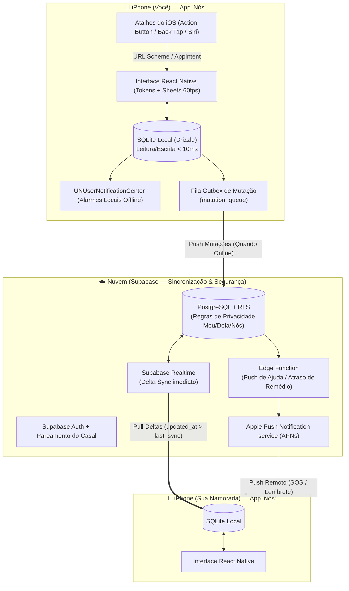
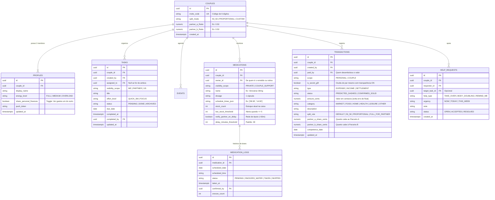

# 04. Arquitetura Técnica, Offline-First, Modelo de Dados e Integração iOS

Este documento detalha as decisões técnicas para você pesquisar e validar como construir o **“Nós”** garantindo funcionamento **100% offline**, **sincronização segura entre os dois aparelhos**, **notificações locais de alta prioridade** e **Atalhos rápidos no iPhone**.

---

## 1. Comparativo de Plataforma (Guia para sua Pesquisa)

| Critério Técnico | Opção 1: **React Native + Expo (Prebuild/CNG)** *(Recomendada)* | Opção 2: **PWA (Web App Instalado no iOS)** | Opção 3: **Swift / SwiftUI Nativo Puro** |
|---|---|---|---|
| **Linguagem / Stack** | TypeScript + React (mesma mentalidade web) | TypeScript + React + Vite | Swift 6 + SwiftUI |
| **Banco Offline Real** | **Excelente:** SQLite nativo (`expo-sqlite` / `op-sqlite`) sem risco de limpeza pelo iOS | **Arriscado no iOS:** o Safari pode limpar `IndexedDB` após dias sem uso ou pouca memória | **Excelente:** SwiftData / CoreData / SQLite |
| **Alarmes Locais Offline (Remédios)** | **100% Confiável:** Agenda gatilhos locais no `UNUserNotificationCenter` do iOS mesmo sem internet | **Limitado:** Web Push no iOS exige internet e servidor; não agenda alarme local offline confiável | **100% Confiável:** Acesso total ao `UNUserNotificationCenter` e `AlarmKit` |
| **Botões na Notificação (`✓ Já engoli` / `+5m`)** | **Nativo:** `Notification Categories` permitem responder na tela bloqueada sem abrir o app | **Fraco:** Não suporta ações nativas ricas em background offline no iOS | **Nativo:** Total suporte |
| **Atalhos do iPhone (`Shortcuts`)** | **Total:** via URL Scheme (`nosapp://...`), API REST + `expo-apple-targets` (`AppIntents`) | **Parcial:** Atalho do iOS só consegue abrir uma aba do Safari ou chamar API se tiver internet | **Total:** `AppIntents` nativo |
| **Curva de Aprendizado** | Baixa/Média para quem já conhece React/TS | Muito baixa | Alta (exige aprender ecossistema Xcode/Swift) |

### Recomendação Consolidada da Stack
- **Mobile App:** `React Native` + `Expo SDK 52+` (usando *Development Builds / Prebuild*) + `Expo Router` + `NativeWind v4` (Tailwind no React Native seguindo nosso `tokens.css`).
- **Armazenamento Local (Offline-First):** `expo-sqlite` (ou `op-sqlite`) + `Drizzle ORM` (migrations tipadas no aparelho) + `MMKV` (para configurações ultra-rápidas como tema e toggles locais).
- **Backend & Sincronização:** `Supabase` (PostgreSQL + Auth + Row-Level Security + Realtime WebSockets + Edge Functions para disparar Push ao parceiro).
- **Motor de Notificações Locais:** `Notifee` ou `expo-notifications` com `interruptionLevel: 'timeSensitive'`.

---

## 2. Diagrama de Arquitetura (Offline-First & Sincronização)

---

## 3. Estratégia Offline-First e Resolução de Conflitos

### Como funciona a leitura e escrita sem internet:
1. **A UI nunca espera pela rede:** Toda ação (`+ Tarefa`, `+ Gasto`, `✓ Tomei remédio`) grava **primeiro** na tabela correspondente do `SQLite` local e insere um registro na tabela local `sync_outbox` (`id`, `entity_type`, `entity_id`, `operation`, `payload_json`, `hlc_timestamp`, `status`).
2. **Sincronização de Subida (`Push Outbox`):** Quando o `NetInfo` detecta conexão (ou quando o app vai para primeiro plano), um worker envia os lotes da `sync_outbox` para o Supabase de forma **idempotente** (usando `UUID v7` gerado no cliente).
3. **Sincronização de Descida (`Pull Delta + Realtime`):** O app busca apenas registros onde `server_updated_at > last_pulled_at` e aplica no SQLite local. Enquanto ambos estão com o app aberto, o `Supabase Realtime` entrega mudanças em `< 300ms`.

### Regras de Resolução de Conflitos
- **Conflito em Conclusão de Tarefa / Dose de Remédio:** **Vence o estado Positivo (`completed` / `taken`)**. Se você marcou a rotina compartilhada como feita offline às 09:00 e ela também marcou às 09:05, o sistema mantém o registro de conclusão das 09:00 sem duplicar o desconto de estoque.
- **Conflito em Edição de Texto / Valor de Gasto:** **Last-Write-Wins (LWW) por coluna**, preservando um registro na tabela `audit_history` para que nada se perca silenciosamente.

---

## 4. Modelo de Dados Completo (ER e Tabelas)

### Índices e Regras de Segurança (Row-Level Security — RLS no Supabase)
1. **Índices Locais e Remotos Obrigatórios:**
   - `idx_tasks_couple_date_status ON tasks (couple_id, due_date, status)`
   - `idx_med_logs_date_status ON medication_logs (scheduled_date, status)`
   - `idx_tx_couple_competence_scope ON transactions (couple_id, competence_date, scope)`
2. **Política RLS para Privacidade Financeira (`transactions`):**
   Um usuário `U` do casal `C` pode ler (`SELECT`) uma linha da tabela `transactions` se e somente se:
   - `created_by = U.id` (é um lançamento criado por ele mesmo), **OU**
   - `scope = 'COUPLE'` (é um gasto ou acerto do casal), **OU**
   - `(scope = 'PERSONAL' AND is_secret_gift = FALSE AND EXISTS (SELECT 1 FROM profiles p WHERE p.id = transactions.created_by AND p.share_personal_finances = TRUE))`
   *(Ou seja: a própria regra do banco garante que, se você desligar o botão de ver os gastos um do outro ou marcar um item como presente surpresa, o outro aparelho nem recebe aquele registro!).*

---

## 5. Alarmes Locais, Push e Integração com Atalhos do iPhone (`iOS Shortcuts`)

### A. Notificações Locais e Alarmes de Remédio no iOS
1. **Agendamento Antecipado Local (7 dias à frente):** O app agenda localmente no iPhone os próximos 7 dias de horários de remédios usando `UNCalendarNotificationTrigger`. Mesmo se o usuário viajar de avião sem internet, o iPhone dispara o alarme no segundo exato.
2. **Nível de Interrupção (`Time-Sensitive`):** Configurado com `interruptionLevel: 'timeSensitive'`, permitindo que o alarme de medicação apareça na tela bloqueada e emita som mesmo durante modos de Foco (Trabalho/Sono), desde que autorizado pelo usuário nas configurações do iOS.
3. **Ações Rápidas na Notificação (`UNNotificationCategory`):**
   - `ACTION_TAKEN`: `"✓ Já engoli"` (executa em background `foreground: false`).
   - `ACTION_SNOOZE_WATER`: `"⏳ Pegando água (+5 min)"` (agenda automaticamente um `UNTimeIntervalNotificationTrigger` para `300 segundos` depois).
4. **Rede de Apoio (Ping de Atraso ao Parceiro):**
   - Ao agendar o remédio das `09:00`, se `notify_partner_on_delay = true`, o servidor agenda uma verificação leve para `09:30`. Se até `09:30` o `MEDICATION_LOGS` não tiver `status = 'TAKEN'`, a Edge Function envia um Push para o parceiro: *"💛 O remédio das 09h de Lucas ainda não foi confirmado. Quer mandar um lembrete?"*.

### B. Como Integrar os 4 Atalhos Rápidos no iPhone (2 Abordagens para Pesquisa)

Você tem **duas maneiras** de fazer os Atalhos do iPhone funcionarem perfeitamente (podendo começar pela #1 no MVP em 1 hora e evoluir para a #2 na v1.1):

1. **Abordagem 1 (Mais rápida para o MVP — Deep Link + API via app Atalhos nativo):**
   - O app registra o esquema `nosapp://`:
     - `nosapp://quick/task?title=...&scope=US`
     - `nosapp://quick/expense?amount=...&scope=COUPLE`
     - `nosapp://quick/med-confirm`
     - `nosapp://quick/sos`
   - No app **Atalhos (Shortcuts)** do iPhone, você cria um atalho de 2 blocos: `Pedir Entrada (Texto/Número)` → `Abrir URL nosapp://...` (ou `Obter Conteúdo de URL` via `POST` para salvar 100% em background sem abrir tela!).
   - Esse atalho pode ser colocado na **Tela Bloqueada**, no **Centro de Controle**, no **Botão de Ação** ou no **Toque Atrás (Back Tap)**.
2. **Abordagem 2 (Nativa Avançada — `App Intents` em Swift via `expo-apple-targets`):**
   - Expor 4 structs `AppIntent` em Swift que leem e gravam direto no banco SQLite compartilhado via **iOS App Group (`group.com.casal.nos`)**, permitindo inclusive falar: *"Siri, confirmei meu remédio no Nós"*.
