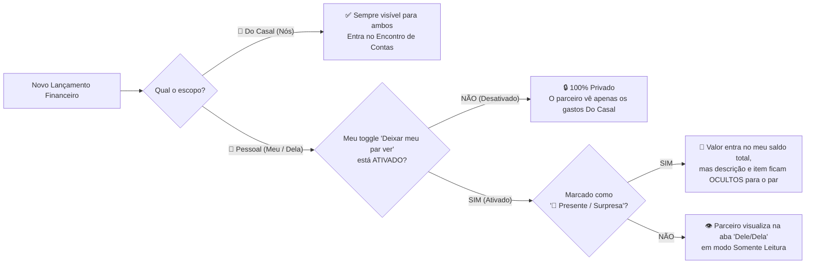

# 05. Modelo Financeiro do Casal e Regras de Privacidade Dinâmica

O módulo financeiro do **“Nós”** foi desenhado especificamente para **evitar a fadiga de planilhas** em pessoas com TDAH: ele não exige conciliação de centavos de extrato bancário, mas resolve com precisão cirúrgica **quanto cada um gastou**, **quanto o casal gastou junto** e **quem deve quanto a quem**.

---

## 1. Os 3 Envelopes e a Chave de Privacidade ("Ver um do outro")

Cada lançamento financeiro pertence a um escopo (`PERSONAL` para `Meu`/`Dela`, ou `COUPLE` para `Do Casal`).

### A Regra da Chave de Transparência Mútua (`share_personal_finances`)
Você definiu que o app deve ter uma função de **ativar ou desativar** a visualização dos gastos pessoais um do outro. O comportamento exato funciona em 3 níveis:

### Por que esse modelo é ideal para o casal?
- **Liberdade sem sensação de vigilância:** Se em um mês um dos dois quiser privacidade total na sua aba pessoal, basta desligar a chave em 1 toque. Os gastos `Do Casal` continuam funcionando normalmente.
- **Transparência quando quiserem planejar juntos:** Quando quiserem sentar no fim de semana para ver para onde está indo o dinheiro de cada um, basta ativar a chave.
- **Proteção de Surpresas (`is_secret_gift`):** Mesmo com a chave ligada, se você comprar uma aliança, um presente de aniversário ou preparar um jantar surpresa, marca o cadeado `🎁 Surpresa` e sua namorada não verá esse item na lista.

---

## 2. Regras de Divisão e Cálculo do Encontro de Contas (`Saldo entre Nós`)

Sempre que um gasto é lançado como **`🤝 Do Casal`**, o sistema registra **quem pagou (`paid_by`)** e **qual regra de divisão (`split_rule`)** se aplica àquele gasto:

### As 4 Regras de Divisão Disponíveis em 1 Toque
1. **Meio a Meio (`50_50`):** Cada um é responsável por `50%` da despesa.
2. **Proporcional à Renda (`PROPORTIONAL`):** Usa a proporção cadastrada no perfil do casal (ex.: Parceiro A ganha `R$ 6.000` e Parceira B ganha `R$ 4.000` → proporção `60% / 40%`).
3. **Adiantamento 100% para o Par (`FULL_FOR_PARTNER`):** Você pagou algo que era 100% da sua namorada (ex.: você passou seu cartão na farmácia para comprar algo exclusivo dela, mas querem acertar depois no encontro de contas do casal).
4. **Valor Personalizado (`CUSTOM`):** Você define manualmente quanto cabe a cada um.

---

## 3. Matemática Exata do Saldo Líquido entre o Casal

Todos os valores são salvos no banco em **centavos inteiros (`amount_cents`)** para jamais sofrerem erros de arredondamento de ponto flutuante (`0.1 + 0.2`).

Para cada despesa confirmada (`status = 'CONFIRMED_SOLID'`) de escopo `COUPLE`:
- Se **Parceiro A (`Você`) pagou** um gasto de `V` centavos onde a parte que cabe à **Parceira B (`Dela`)** é `Share_B`:
  $$\text{Crédito de A sobre B} = + \text{Share\_B}$$
- Se **Parceira B (`Dela`) pagou** um gasto de `V` centavos onde a parte que cabe ao **Parceiro A (`Você`)** é `Share_A`:
  $$\text{Crédito de A sobre B} = - \text{Share\_A}$$

### Fórmula do Saldo Líquido do Mês (`Net Balance`):
$$\text{Saldo Líquido} = \sum (\text{Share\_B pagos por A}) - \sum (\text{Share\_A pagos por B}) - \sum (\text{Acertos/Pix já transferidos de B para A})$$

### Exemplo Prático (Visível na Tela `T05: Finanças`):
1. **Supermercado (`R$ 300,00`):** Você pagou, divisão `50/50` → Parte dela = `R$ 150,00` *(Ela te deve `R$ 150,00`)*.
2. **Conta de Energia (`R$ 200,00`):** Ela pagou, divisão `50/50` → Parte sua = `R$ 100,00` *(Você deve `R$ 100,00` a ela)*.
3. **Jantar Delivery (`R$ 120,00`):** Você pagou, divisão `50/50` → Parte dela = `R$ 60,00` *(Ela te deve `R$ 60,00`)*.
4. **Resultado Automático no Topo da Tela:**
   > **`Saldo atual de acerto:`** `Ela transfere R$ 110,00 para Lucas para zerar o mês` (`150 - 100 + 60 = 110`).
5. Quando ela faz o Pix de `R$ 110,00`, basta clicar em **`[ ✓ Registrar Acerto ]`**: o app cria uma transação do tipo `SETTLEMENT` e o saldo do casal fica **`R$ 0,00 · Contas em dia! ✨`**.

---

## 4. Diferenciação Visual: Realizado (Sólido) vs. Previsto (Tracejado)

Seguindo a metáfora do **"Livro-Razão Vivo"** de [`product-ui-system.md`](file:///C:/Users/Lucas/.gemini/config/skills/frontend-figma-playwright/references/product-ui-system.md):
- **Gastos Realizados / Contas já Pagas (`CONFIRMED_SOLID`):**
  - Aparecem com borda **sólida (`1px solid`)**, ícone `CircleCheck` e entram imediatamente no saldo de acerto de quem deve a quem.
- **Contas Fixas Previstas do Mês (`PREDICTED_DASHED` — Aluguel, Condomínio, Internet, Luz):**
  - Aparecem com borda **tracejada (`1px dashed`)**, ícone `CircleDashed` e ficam no bloco **"Previsto até o fim do mês"**.
  - Assim vocês sabem exatamente quanto dinheiro ainda vai sair no mês, mas o valor só entra na dívida entre os dois no momento em que alguém clica em **`[ Marcar como Pago ]`** e informa quem pagou.
