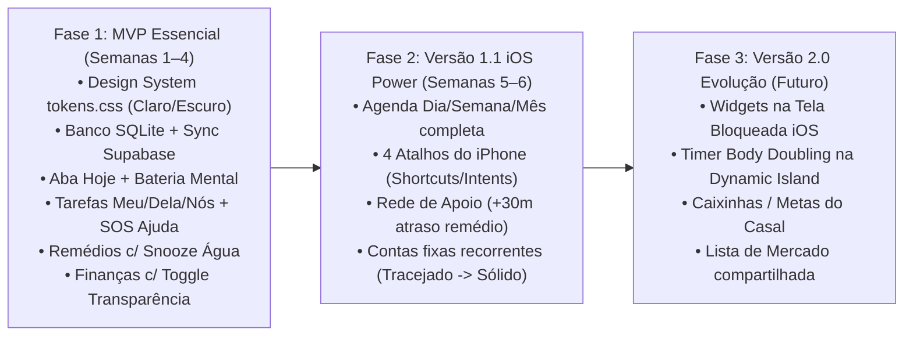

# 06. Backlog Priorizado, Roadmap por Fases, Riscos e Como Instalar no iPhone

---

## 1. Backlog Priorizado (Épicos, User Stories e Critérios de Aceite)

### ÉPICO 1 — Fundação Offline-First & Espaço do Casal (Prioridade P0)
- **US-01 (Pareamento do Casal):** Como usuário, quero criar meu perfil e gerar um código de 6 dígitos para conectar minha conta à da minha namorada, para termos nosso espaço compartilhado seguro.
  - *Critério de aceite:* Ambos os aparelhos sincronizam o `couple_id` e definem a regra padrão de divisão (`50/50` ou `Proporcional`).
- **US-02 (Persistência Local SQLite + Fila Outbox):** Como usuário com TDAH em trânsito, quero que qualquer tarefa, remédio ou gasto seja salvo instantaneamente no celular mesmo sem internet, sincronizando sozinho depois.
  - *Critério de aceite:* Desligar o Wi-Fi/4G, criar 3 itens, fechar o app, abrir novamente (itens persistem) e religar a internet (itens aparecem no celular do parceiro em `< 5s`).

### ÉPICO 2 — Painel `Hoje`, Tarefas e Co-regulação TDAH (Prioridade P0)
- **US-03 (Painel de Aterrissagem Calma + Bateria Mental):** Como usuário, quero abrir o app e ver primeiro minha próxima ação imediata e poder mudar minha bateria mental (`🔋 Cheia`, `⚡ Média`, `🪫 Sobrecarga`) para reduzir o excesso de informação em dias difíceis.
  - *Critério de aceite:* Ao ativar `🪫 Sobrecarga`, a lista oculta tarefas secundárias e notifica sutilmente o parceiro.
- **US-04 (Captura de Tarefas `Meu / Dela / Nós` + Toast Desfazer):** Como usuário, quero criar uma tarefa em menos de 3 segundos e poder enviá-la para minha namorada ou para nós dois.
  - *Critério de aceite:* Concluir qualquer tarefa exibe `Toast` de 5s com botão `[Desfazer]` funcional.
- **US-05 (Modal de Pedido de Ajuda em 3 Cliques — `ARQ-E`):** Como usuário travado numa demanda, quero pedir ajuda escolhendo entre *"Assumir por mim"*, *"Fazer comigo (Body Doubling)"* ou *"Me lembrar mais tarde"*.
  - *Critério de aceite:* Parceiro recebe Push e card destacado no topo da aba `Hoje` com resposta em 1 toque.

### ÉPICO 3 — Alarmes de Remédios, Snooze de Água e Rede de Apoio (Prioridade P0)
- **US-06 (Alarme Local `Time-Sensitive` com Confirmação em 2 Estágios):** Como usuário que toma medicação contínua, quero responder direto na notificação do iPhone se `✓ Já engoli` ou se estou `⏳ Pegando água (+5 min)`.
  - *Critério de aceite:* Clicar em `+5 min` reagenda um novo alarme local em exatos 300 segundos; clicar em `Já engoli` registra o horário real e reduz `-1` no estoque da caixa.
- **US-07 (Rede de Apoio do Par em Atraso de Medicação):** Como usuário, quero ativar em remédios críticos a opção de avisar meu par caso eu atrase mais de 30 minutos.
  - *Critério de aceite:* Se a dose não constar como `TAKEN` 30 min após o horário, o parceiro recebe notificação empática.

### ÉPICO 4 — Finanças `Meu / Dela / Nós` e Toggle de Transparência (Prioridade P0)
- **US-08 (Registro Rápido de Gasto e Encontro de Contas):** Como casal, queremos lançar gastos pessoais ou do casal (sólido = pago, tracejado = previsto) e ver na hora quem deve quanto a quem no mês.
  - *Critério de aceite:* Cálculo em centavos exatos suportando divisão `50/50`, `Proporcional` e `100% adiantado`, mais botão de `Registrar Acerto`.
- **US-09 (Toggle "Ver um do outro" + Modo Surpresa):** Como usuário, quero um botão para ativar ou desativar a visualização dos meus gastos pessoais pelo meu par, além de poder ocultar um item específico como `🎁 Presente / Surpresa`.
  - *Critério de aceite:* Com o toggle desligado, a aba pessoal fica bloqueada para o outro no banco (RLS) e na UI; com o toggle ligado, itens normais aparecem em leitura e itens `🎁 Surpresa` continuam ocultos.

### ÉPICO 5 — Agenda (`Dia / Semana / Mês`) e Atalhos do iPhone (Prioridade P1)
- **US-10 (Agenda Unificada):** Visualizar compromissos, vencimentos de contas e tarefas por Dia, Semana e Mês.
- **US-11 (4 Atalhos Rápidos no iOS):** Disparar `+ Tarefa`, `+ Gasto`, `✓ Remédio` e `🆘 Ajuda` pelo app Atalhos do iPhone (Action Button / Back Tap / Tela Bloqueada).

---

## 2. Roadmap de Entrega por Fases

---

## 3. Riscos Técnicos e Como Resolver na Sua Pesquisa

| Risco Identificado | Impacto | Estratégia de Mitigação Prática |
|---|---|---|
| **Como instalar o app no iPhone de vocês dois sem pagar US$ 99/ano da Apple logo no início?** | Alto (custo inicial) | **3 opções para você escolher:** 1. **Grátis via Cabo/Wi-Fi (Xcode / AltStore / SideStore):** instala nos 2 iPhones usando seu Apple ID gratuito (renova assinatura automaticamente no Wi-Fi de casa com SideStore). 2. **Modo Híbrido Web/PWA + Atalhos iOS via API:** usar como PWA instalado na Tela de Início nos primeiros testes enquanto valida o layout. 3. **Conta Apple Developer (`US$ 99/ano`):** libera **TestFlight** para instalar e atualizar nos dois iPhones de qualquer lugar por até 1 ano sem precisar de cabo, além de liberar `Critical Alerts` e `Push Notifications` completos. |
| **Fadiga de preenchimento (abandono típico de quem tem TDAH após 2 semanas)** | Alto (produto) | Garantir que **nenhum formulário exija mais de 2 toques obrigatórios**. Data, pagador e divisão vêm sempre pré-preenchidos. Se ficarem dias sem abrir, usar o botão **"Recomeço Leve em 1 toque"** em vez de cobrar itens atrasados. |
| **Dessincronização de alarmes locais quando o parceiro já cumpriu a rotina** | Médio (UX) | Quando um parceiro marca uma rotina compartilhada (ex.: *Dar comida ao pet*) como concluída, o Supabase envia um *Silent Push* (`content-available: 1`) para o segundo iPhone cancelando o alarme local daquele turno. |

---

## 4. Plano de Testes e Validação (`validation.md` & `product-ui-system`)

1. **Testes Unitários (`Vitest` / `Jest`):**
   - Motor de cálculo financeiro em centavos (`50/50`, `Proporcional`, `100% adiantado` e `Settlement`).
   - Regras do filtro de privacidade (`share_personal_finances = true/false` combinado com `is_secret_gift = true/false`).
   - Máquina de estados do alarme de remédio (`PENDING` → `SNOOZED_WATER` → `TAKEN` e decremento de estoque).
2. **Testes de Sincronização Offline:**
   - Criar e editar registros com rede desconectada em ambos os clientes e validar a convergência da fila `sync_outbox`.
3. **Auditoria Visual e Acessibilidade (`product-ui-system`):**
   - Conferir contraste WCAG AA (`≥ 4,5:1`) em todos os tokens no claro e no escuro.
   - Conferir ausência de estados baseados apenas em cor (`Forma + Texto + Cor + Borda sólida/tracejada`).
   - Validar alvos de toque `≥ 48px` e zero overflow horizontal a partir de `360px` de largura.
