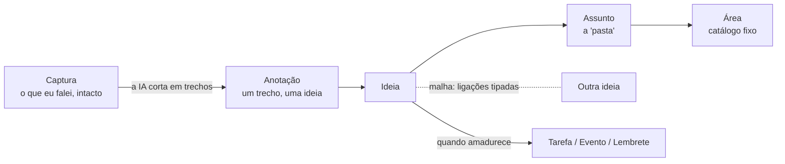
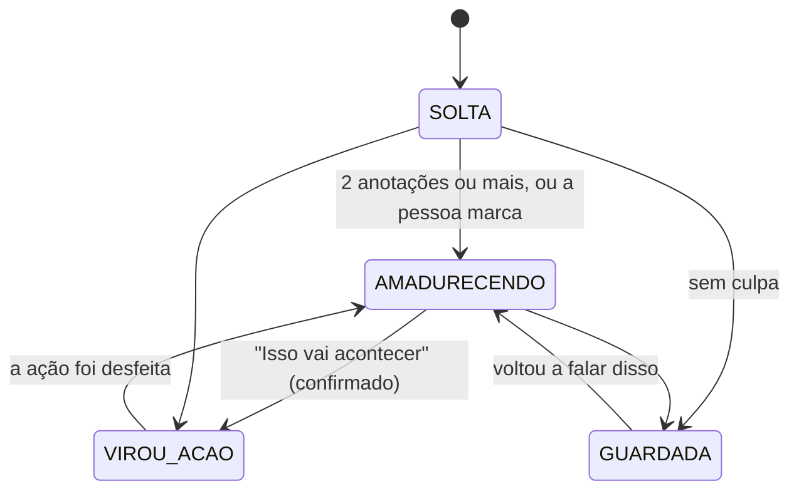
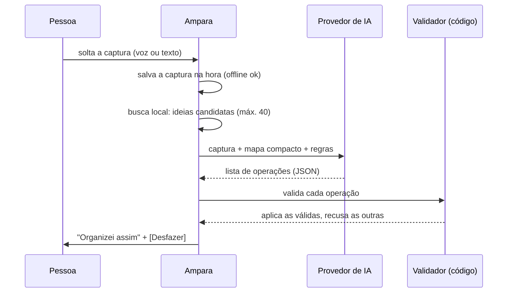

# 08. Ideias: o segundo cérebro do Ampara

> Status: **aceita** em 2026-11-23 (ADRs 0001 a 0009). Implementação em andamento: veja `IMPLEMENTATION_PLAN.md`.
> As decisões estão nas ADRs em [`adr/`](adr/README.md). Este documento é a especificação que elas referenciam.

## 1. O problema

A pessoa tem TDAH e dislexia. Os pensamentos chegam soltos, repetidos e misturados.

Ela precisa de três coisas:
- **Soltar** um pensamento em segundos, de qualquer lugar (celular, web, PC).
- **Ver sentido** depois: cada assunto no seu lugar, sem bagunça nova.
- **Agir** só quando uma ideia amadurecer: aí ela vira tarefa, evento ou lembrete.

O risco principal: deixar a IA organizar "do jeito dela". O resultado seria pastas demais, nomes que mudam e ligações inventadas. Ou seja, uma segunda bagunça.

**Princípio:** a **estrutura é fixa e pequena**. A IA só **escolhe dentro dela** e **propõe** mudanças. **O código valida** tudo antes de gravar. A pessoa tem a palavra final.

## 2. A estrutura (4 níveis, profundidade fixa)

| Nível | O que é | Quem cria | Limites |
|---|---|---|---|
| **Área** | Grande parte da vida | Catálogo inicial do app. A pessoa pode renomear ou esconder. | Mínimo 1, máximo **10** ativas |
| **Assunto** | A "pasta" de um tema (ex.: "Viagem para o Sul") | A IA propõe como **provisório**. Ele vira **firme** com a confirmação da pessoa ou com 3 ideias dentro. | Máximo **12 ativos por Área**. Passou disso, a IA propõe juntar. |
| **Ideia** | Um pensamento com começo, meio e fim possível | A IA ou a pessoa | Título com até **8 palavras**. Resumo com até **2 frases**. |
| **Anotação** | Um trecho do que a pessoa falou, preso a uma Ideia | Gerada da Captura | Texto **literal** da captura. Até 4000 caracteres. |
| **Captura** | Tudo o que a pessoa soltou de uma vez (voz ou texto) | A pessoa | Imutável. Até 8000 caracteres. |

A **Caixa de entrada** não é uma Área. Ela recebe as anotações que a IA não soube encaixar com segurança, ou todas, quando não há IA.

### 2.1 Áreas iniciais (catálogo fixo)

`Trabalho` · `Estudos` · `Saúde` · `Casa` · `Dinheiro` · `Relações` · `Projetos pessoais` · `Lazer e criatividade`

O catálogo evita que cada pensamento invente uma pasta de topo. Renomear não muda o `id`, então nenhuma ligação quebra.

### 2.2 Natureza da ideia (vocabulário fechado)

Toda Ideia tem **uma** natureza. Ela serve para filtrar ("me mostra minhas preocupações") e muda como a IA sugere ações.

| Natureza | Exemplo |
|---|---|
| `PLANO` | "Quero fazer um curso de inglês" |
| `DESEJO` | "Seria bom morar perto do mar" |
| `PREOCUPACAO` | "Tenho medo de não pagar o cartão" |
| `PERGUNTA` | "Será que vale trocar de emprego?" |
| `OBSERVACAO` | "Rendo melhor de manhã" |
| `REFLEXAO` | "Percebi que evito ligações" |

### 2.3 Estados da ideia

- A IA **pode sugerir** uma troca de estado, mas não troca sozinha. A única exceção é `SOLTA → AMADURECENDO`, que é automática e se desfaz com um toque.
- `VIROU_ACAO` só acontece pela pessoa (ADR-0001). A ideia **continua existindo**, ligada à tarefa ou ao evento.

## 3. A malha de pensamento

As ideias se ligam por **ligações tipadas**, inclusive entre Áreas diferentes. É isso que transforma a lista numa **malha**.

| Tipo | Significado | Exemplo |
|---|---|---|
| `RELACIONA` | Falam da mesma coisa por ângulos diferentes | "Correr de manhã" ↔ "Dormir melhor" |
| `DEPENDE_DE` | Uma só anda depois da outra | "Viajar" → depende de → "Juntar 3 mil" |
| `PARTE_DE` | Uma é um pedaço da outra | "Comprar tênis" → parte de → "Correr de manhã" |
| `CONTRADIZ` | Puxam para lados opostos | "Trocar de emprego" ↔ "Comprar casa este ano" |
| `EVOLUI_DE` | Uma ideia nova é a versão nova de uma antiga | "Curso online" → evolui de → "Faculdade de noite" |

Regras:
- Ligação sugerida pela IA nasce **tracejada** (`SUGERIDA`). Ela fica **sólida** (`CONFIRMADA`) quando a pessoa aceita. É o mesmo idioma visual do Ampara: tracejado = previsto, sólido = confirmado.
- Toda ligação tem um **motivo** de uma frase. Sem motivo, o código rejeita.
- A IA sugere no máximo **3 ligações por captura** e **5 por ideia** no total.
- Ligações rejeitadas ficam lembradas, para a IA não sugerir de novo.

## 4. Como a IA organiza (o contrato)

### 4.1 Fluxo

**A captura nunca espera a IA.** Ela é salva primeiro, como no "captura em menos de 3 segundos" do Ampara. Sem IA, ou sem internet, ela vai para a Caixa de entrada.

### 4.2 O que a IA recebe

- A **captura** inteira.
- O **mapa compacto**: as Áreas (`id`, nome), os Assuntos (`id`, nome, área) e até **40 ideias candidatas** (`id`, título, resumo de 1 frase, natureza, assunto). Os candidatos vêm da busca local: palavras em comum e assuntos usados recentemente.
- As **regras** desta seção, com a versão do prompt (ex.: `organizador@1`).

### 4.3 O que a IA pode devolver (lista fechada de operações)

| Operação | Campos | Efeito |
|---|---|---|
| `ANEXAR` | `trecho`, `ideia_id`, `confianca` | Cria uma Anotação numa ideia que já existe |
| `CRIAR_IDEIA` | `trecho`, `assunto_id` ou `assunto_ref`, `titulo`, `natureza`, `confianca` | Cria uma Ideia com a primeira Anotação |
| `CRIAR_ASSUNTO` | `ref`, `area_id`, `nome`, `motivo` | Cria um Assunto **provisório** (usado por `assunto_ref`) |
| `CAIXA_DE_ENTRADA` | `trecho`, `motivo` | Deixa o trecho para a pessoa decidir |
| `SUGERIR_LIGACAO` | `de_ideia`, `para_ideia`, `tipo`, `motivo`, `confianca` | Cria uma ligação `SUGERIDA` |
| `ATUALIZAR_RESUMO` | `ideia_id`, `resumo` | Reescreve o resumo (nunca as anotações) |
| `SUGERIR_ESTADO` | `ideia_id`, `estado`, `motivo` | Só uma sugestão. A pessoa aceita ou não. |

**Não existe** operação de apagar, mover uma ideia firme de assunto ou mudar uma Área. Essas mudanças só acontecem como **propostas** na revisão (seção 6) ou pela pessoa.

### 4.4 Regras que o código confere (validador)

1. **O trecho precisa estar escrito literalmente na captura** (comparação normalizada de espaços). Isso impede a IA de inventar o que a pessoa "disse".
2. Os trechos da mesma captura não se sobrepõem. Juntos, eles cobrem a captura toda. A sobra que não tiver sentido (por exemplo, "hmm", "tipo") pode ser descartada.
3. Todo `id` citado existe e pertence à pessoa.
4. `natureza`, `tipo` e `estado` estão no vocabulário fechado.
5. Os limites são respeitados: título com até 8 palavras, resumo com até 2 frases, 12 assuntos por área, 3 ligações por captura.
6. `confianca` controla o destino:
   - `≥ 0,8`: aplica.
   - `0,6 a 0,8`: aplica e marca **"conferir"**, com borda tracejada.
   - `< 0,6`: vai para a **Caixa de entrada**.
7. Uma operação inválida é **recusada sozinha**, sem derrubar as outras. O que ela deveria encaixar vai para a Caixa de entrada.

### 4.5 Registro e desfazer

- Cada organização grava um **registro** com a captura, o provedor, o modelo, a versão do prompt, as operações recebidas e o resultado de cada uma.
- **[Desfazer]** volta toda a organização daquela captura. A captura em si continua salva.
- Em cada anotação, a pessoa toca em **"Por que aqui?"** e vê o motivo e a confiança.

## 5. Perguntar depois

Exemplos: "o que eu já falei sobre o curso?" ou "quais preocupações eu tive com dinheiro este mês?".

1. **Busca local primeiro:** texto normalizado (sem acento, minúsculo), filtros de Área, natureza, estado e período. Ela pega até 30 anotações.
2. A IA recebe **só essas anotações**, com os `id`s, e responde em até 6 linhas.
3. **A resposta precisa citar** as anotações usadas (`[n:ID]`). O código confere se cada citação existe. Uma frase sem citação aparece como "sem fonte".
4. **Perguntas nunca mudam a estrutura.** Para mudar algo, a pessoa pede uma organização ou uma revisão.

## 6. Revisão (ritual opcional)

Uma vez por semana, ou quando a pessoa pedir, a IA olha o mapa todo e **só propõe**:
- juntar assuntos parecidos;
- guardar ideias paradas há mais de 30 dias;
- uma ligação que ficou óbvia;
- mover uma ideia de assunto.

Cada proposta é um cartão com **[Aceitar]** e **[Agora não]**. Ela segue a regra do Ampara de mostrar uma coisa por vez e não aparece no modo sobrecarga.

## 7. Concretizar ("Isso vai acontecer")

1. A pessoa toca no botão dentro da ideia.
2. A IA sugere **uma** forma de ação, conforme a natureza e as anotações: uma **tarefa com passos** (usa `tasks.steps`), um **evento** ou um **lembrete**.
3. A pessoa confere, edita e confirma. Nada é criado sem esse toque.
4. A ação guarda o vínculo `ideia_id`. A ideia mostra "Virou: tarefa X". A tarefa mostra "Veio da ideia Y".

## 8. O mapa mental interativo (visão)

Detalhes em [ADR-0007](adr/0007-mapa-mental-interativo-com-zoom-por-nivel.md).

| Nível de zoom | O que aparece |
|---|---|
| **Céu** | As Áreas como círculos grandes. O tamanho mostra quantas ideias ativas cada uma tem. |
| **Área** | Os Assuntos da Área, e as ideias como folhas |
| **Assunto** | As ideias com estado, natureza e número de anotações |
| **Ideia** | O cartão: resumo, linha do tempo das anotações, ligações e ações |

- **Malha ligada ou desligada:** mostra as ligações entre Áreas por cima do mapa (sólido = confirmada, tracejado = sugerida).
- **Filtros:** natureza, estado e período ("o que eu soltei esta semana").
- **Esboço:** a mesma estrutura em lista recolhível, como alternativa completa para celular de 360 px, teclado e leitor de tela.

## 9. Glossário rápido

| Termo | Em uma frase |
|---|---|
| Captura | O que eu soltei de uma vez, guardado sem mudança |
| Anotação | Um trecho literal da captura, preso a uma ideia |
| Ideia | Um pensamento que junta anotações ao longo do tempo |
| Assunto | A pasta de um tema dentro de uma Área |
| Área | Uma grande parte da vida, de uma lista fixa |
| Malha | As ligações tipadas entre ideias |
| Provedor | Quem roda a IA: assinatura no PC ou chave de API |
